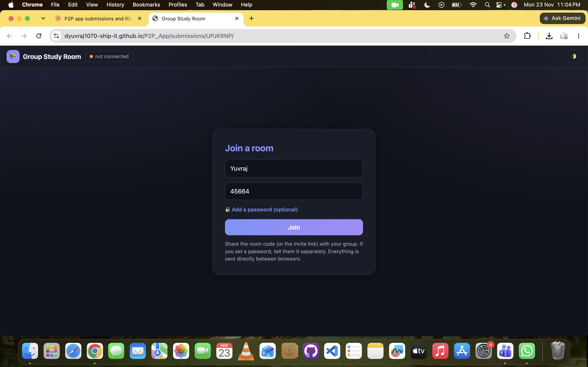
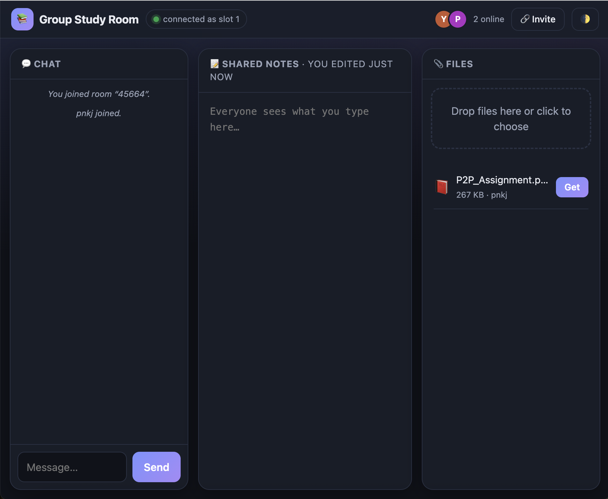
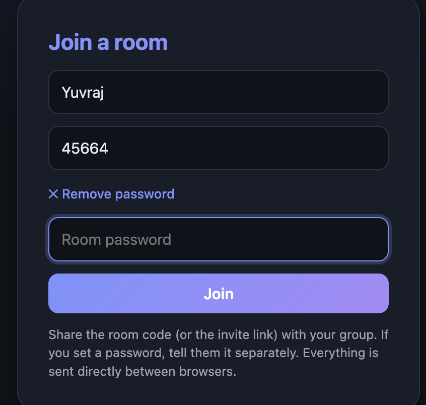
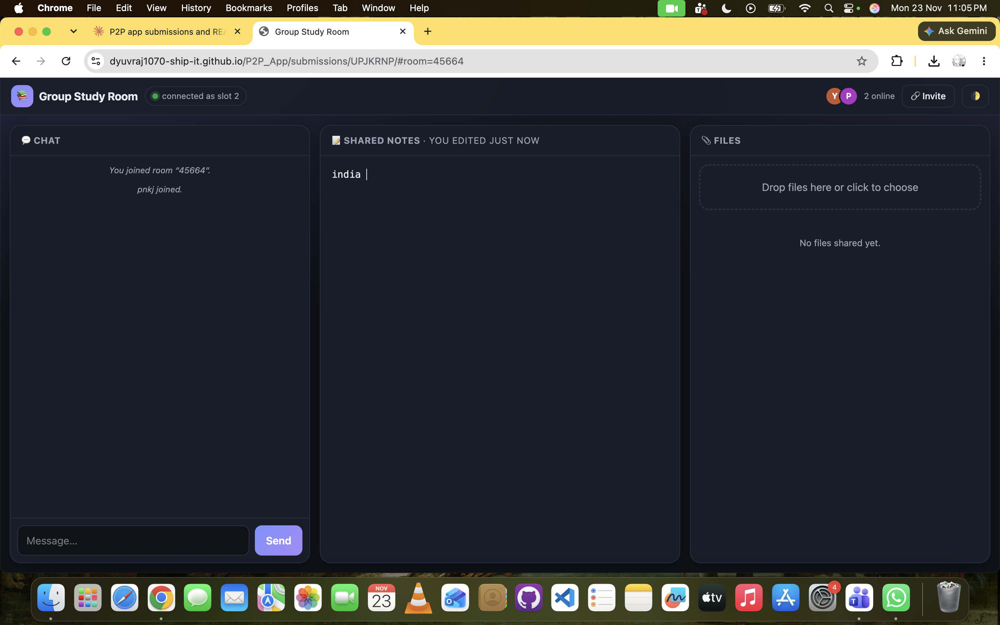

# Group Study Room

**Group:** UPJKRNP

A serverless study room: **chat**, a **shared notes pad**, and **file drops**.
All user data travels browser-to-browser over WebRTC data channels. There is no backend and no database.

**Live app:** https://dyuvraj1070-ship-it.github.io/P2P_App/submissions/UPJKRNP/

## Members

| Name | SAP ID | GitHub username |
|---|---|---|
| Yuvraj Dhiman | 590025374 | dyuvraj1070-ship-it |
| Pankaj Singh | 590028972 | Notbing00 |
| Arnav Verma | 590027671 | lackofbraincellsverma |
| Vipransh Sharma | 590022121 | vipransh-upes |

## How to use
1. Open the link on two or more devices.
2. Enter a name and the same room code (and the same password, if the room has one), or open a shared link containing `#room=CODE`.
3. Chat, edit the notes together, or drop files. Click **Get** on a file to pull it from its owner.

## Libraries and services
- [PeerJS](https://peerjs.com/) (MIT), the WebRTC wrapper, loaded from jsDelivr.
- PeerJS Cloud public broker (`0.peerjs.com`) for signalling only.
- Google public STUN (`stun.l.google.com`) and Twilio public STUN (`global.stun.twilio.com`).
- [Open Relay](https://www.metered.ca/tools/openrelay/) free TURN by Metered.
- Browser APIs: WebRTC data channels, Web Crypto (PBKDF2), `localStorage`, File System Access (large files, Chrome/Edge only).

## How it works
- **Room discovery without a server.** Each peer claims the lowest free slot ID (`studyroom-<room>-<0..9>`) on the public PeerJS broker, then dials every other slot to build a full mesh. There is no host, so the room survives anyone leaving. Limit: 10 people.
- **Signalling vs data.** The broker only exchanges connection setup (SDP/ICE). Chat, notes, and files never touch it.
- **Chat.** Messages are broadcast with unique IDs (de-duplicated) and ordered by a Lamport counter. Newcomers receive the history from the peers they connect to. Join and leave notices are kept in a separate list, so new messages never erase them.
- **Notes.** Last-writer-wins on the whole document, using a Lamport clock with slot ID as tie-break. Remote updates keep your caret in place. Newcomers receive the current notes on join.
- **Files.** Only metadata is broadcast. The owner streams the file in 16 KB chunks on request, with back-pressure on the data channel, and the receiver reassembles it into a downloadable Blob. The owner must stay online.

## P2P mesh (Vipransh Sharma)
This is the part that lets browsers find and talk to each other without any backend of our own. Everything else (chat, notes, files, UI) sits on top of the connections built here.

**1. Finding each other with no server.** WebRTC needs some way to exchange connection details, so we use the free PeerJS Cloud broker for signalling only. Each browser tries to register the peer ID `studyroom-<room>-<n>`, starting at `n = 0`. If the broker answers `unavailable-id`, that slot is taken, so the app destroys that attempt and tries `n + 1`, up to slot 9. The first free slot becomes that person's identity in the room.

**2. Building a full mesh.** Once a peer owns a slot, it dials every other slot (0 to 9). Empty slots fail with `peer-unavailable`, which is expected and ignored. The result is that every person is directly connected to every other person, with no host in the middle. If anyone leaves, the rest of the room carries on.

```
slot 0 ─── slot 1
  │  ╲   ╱  │       every pair has its own WebRTC data channel;
  │   ╲ ╱   │       the broker is used only to set them up
slot 2 ─── slot 3
```

**3. Connecting across different networks.** The ICE configuration uses two public STUN servers (Google, Twilio) and the Open Relay TURN service (including TURN over TCP/443) as a fallback for strict campus or office Wi-Fi. If nobody connects within 20 seconds, the chat suggests checking the room code and password or trying a phone hotspot.

**4. One link per pair of people.** Because nobody coordinates, two people joining at the same moment can dial each other. Each connection remembers which slot dialled it, and both sides keep the link dialled by the lower slot and close the other. See problem 4 below.

**5. Bringing newcomers up to date.** When a link opens, each side sends a `hello` message with its name, chat history, notes and file catalogue, and the other side merges it. Join and leave notices come from this layer when a link opens or closes.

**6. Room isolation.** The optional password is stretched with PBKDF2 and becomes part of the peer IDs, so people with a different code or password land in a different room namespace. See problem 6 below.

Limits of this design: at most 10 people per room, and it depends on the free public broker, STUN and TURN services being available.

## Technical challenges in the design
These are the design-level challenges we had to solve (lettered so they are not confused with the numbered problems in the next section).
- **A. NAT traversal between different networks:** STUN plus TURN fallback (including TURN over TCP/443).
- **B. Peer discovery with no server:** slot claiming on the public broker plus a full mesh.
- **C. Late-joiner state sync:** chat history, notes and the file catalogue are sent in a `hello` message on connect.
- **D. Concurrent edit conflicts:** Lamport-clock last-writer-wins with caret preservation.
- **E. Large file transfer:** chunking, back-pressure, progress bar, streaming to disk for big files.
- **F. Duplicate connections and presence:** a deterministic tie-break (keep the link dialled by the lower slot) and join/leave notices.

## Problems from section 3 of the brief: which ones we cover and how

| # | Problem | Why it happens | How it is handled here |
|---|---|---|---|
| 1 | Late joiners see no history | Messages are sent only to people online at that moment. | On connect, each peer sends a `hello` with its chat history, notes and file catalogue; the newcomer merges it. |
| 2 | Data lost on refresh | Everything is in memory; a refresh clears it. | Chat (last 500 messages) and notes are saved to the browser's `localStorage` per room and restored on rejoin, then re-synced with peers. Files are not persisted: the owner must re-share after a refresh. |
| 3 | Messages in the wrong order | Device clocks differ; two people send at the same moment. | Each message carries a Lamport counter; messages sort by counter, then timestamp, then ID, so every device shows the same order. |
| 4 | Duplicate messages | The same message may arrive twice after reconnecting or history sync. | Every message has a unique ID; IDs already seen are ignored (also applies to restored history). |
| 5 | Peers cannot connect | Campus or office Wi-Fi blocks direct connections. | STUN plus TURN fallback (including TURN over TCP/443). If nobody connects within 20 seconds, the chat suggests trying a phone hotspot. |
| 6 | Large files crash the tab | Received files are held in memory. | Files over 25 MB are streamed chunk-by-chunk straight to disk where the browser supports the File System Access API (Chrome/Edge). Other browsers show a warning before loading the file into memory. Hard cap: 100 MB. |
| 9 | Malicious or malformed input | Any peer can send anything over the data channel. | Every incoming message is type-checked and size-limited before use (chat 2,000 characters, notes 200,000, file names 255, at most 500 history items and 100 files per `hello`). Text is only ever shown with `textContent`, so HTML cannot be injected. File chunks are accepted only from the file's owner, and their size and index are checked. |
| 11 | Strangers entering a room | Anyone who guesses the room code can join. | Optional room password (see below). Only people with the same code **and** password end up in the same room. |

Problem 8 (fake identities) is **not** solved: anyone can type any name, and we do not claim otherwise. The per-tab client ID only keeps your own messages labelled "You" (see problem 2 under "Problems we actually faced").

## Problems we actually faced while building

### 1. Join and leave notices kept disappearing from the chat
- **Problem:** The italic "X joined" and "X left" lines showed up and then vanished as soon as the next chat message arrived.
- **Why it happened:** The first version drew the chat by clearing the message box and redrawing only the chat messages. The notices were never stored anywhere, so every redraw wiped them.
- **What we tried:** We first added the notices straight into the message box, which is exactly what the redraw erased.
- **Final solution:** Notices now live in their own `events` list with a timestamp. `renderChat()` merges that list with the messages by time on every redraw, so a new message never removes a notice.

### 2. Two people with the same name both saw each other's messages as "You"
- **Problem:** If two users typed the same display name, each saw the other's messages labelled "You" and shown on the "mine" side.
- **Why it happened:** "Is this my message?" was decided by comparing names, and names are free text that anyone can repeat.
- **What we tried:** Comparing names was the first approach. Making names unique is not possible without a server, because no device can see every name that will ever join.
- **Final solution:** Each browser tab creates a random client ID (stored in `sessionStorage`) and attaches it to every message it sends. A message counts as "mine" only if its client ID matches ours. Names can still repeat, so this fixes the labelling but not fake identities (problem 8).

### 3. A peer could send huge or malformed data
- **Problem:** The app accepted whatever a peer sent. An oversized message could slow every browser in the room, and a wrongly shaped one could throw errors.
- **Why it happened:** WebRTC data channels deliver any object a connected peer chooses to send, and our first handlers trusted the fields without checking them.
- **What we tried:** All text is displayed with `textContent`, which already stops HTML and script injection. That did nothing about size or shape.
- **Final solution:** Every incoming message goes through a `clean...` function that checks types and limits (chat 2,000 characters, notes 200,000, file names 255, at most 500 history items and 100 files in a `hello`). File chunks are accepted only from the file's owner, and their size and index are checked. Anything that fails is silently dropped.

### 4. Two peers opened a connection to each other at the same time
*Area: P2P mesh (Vipransh Sharma)*
- **Problem:** Two people could end up connected twice, once in each direction.
- **Why it happened:** With no host, every peer dials every other slot as soon as it joins. When two peers join at nearly the same moment, each dials the other.
- **What we tried:** Our first attempt was to keep whichever connection opened first and close the later one. That rule cannot work on its own, because the two sides may see the two links open in a different order and each close a different one, leaving no connection at all.
- **Final solution:** Each connection records which slot dialled it. When a second link to the same slot opens, both sides keep the one dialled by the lower slot number and close the other. Both sides apply the same rule, so they always agree.

### 5. The text cursor jumped when someone else edited the shared notes
- **Problem:** While you were typing in the notes, a remote update could throw your cursor to the end of the text.
- **Why it happened:** Setting a textarea's `value` from code resets the caret position. Every remote update did that.
- **What we tried:** Our first attempt was to save the caret position before setting the new text and restore the same number afterwards. That is not enough, because it drifts when the remote change adds or removes text before the caret.
- **Final solution:** We compare the old and new text to find the part that changed, then shift the caret by the length difference when the change is before it. The caret stays where the person was typing.

### 6. A wrong password gave no error and just showed an empty room
*Area: P2P mesh (Vipransh Sharma)*
- **Problem:** Someone who typed the wrong password saw a normal-looking room with nobody in it.
- **Why it happened:** The password is hashed into the peer IDs, so a different password means a different room namespace. There is no server to check the password and reject it.
- **What we tried:** We could not show an "incorrect password" message, because the app cannot tell the difference between an empty room and a wrong password.
- **Final solution:** If nobody connects within 20 seconds, the chat prints a hint to check that the room code and password match exactly, or to try a phone hotspot. The README documents this behaviour.

## Optional room password
On the join screen, click **Add a password (optional)**. The password is stretched with PBKDF2-SHA256 (100,000 rounds, salted with the room code) and the result becomes part of the room's peer IDs, so only people who enter the same room code **and** password find each other. Notes:
- A wrong password does not show an error; it lands you in a different, empty room. The chat hints at this if nobody connects after 20 seconds.
- Invite links to protected rooms carry `lock=1` (so the password box appears) but never the password itself. Share the password separately.
- The broker only ever sees a one-way hash fragment, never the password. Needs HTTPS (GitHub Pages is fine).
- This is a shared-secret room, not per-user accounts: anyone who knows both can join, and a weak password can be guessed.

## UI features
Light/dark theme toggle, status indicator, avatar stack of who is online, chat bubbles with an unread badge on mobile, one-click invite link, and file cards with type icons and progress bars. The layout is responsive (tabs on phones).

## Limitations
- Files live only in the owner's browser memory, so the owner must stay online and must re-share after a refresh.
- Maximum 10 people per room and 100 MB per file.
- Display names are not unique and are not verified.
- There is no rate limiting, so a malicious peer could still flood a room with valid messages.
- Notes use last-writer-wins on the whole document, so two people typing at the exact same moment can overwrite each other's change.
- Relies on free public services (PeerJS broker, STUN, Open Relay TURN) that could be slow or unavailable.

## Privacy note
Browsers talk directly where possible. When a direct path is impossible, the public TURN relay forwards **DTLS-encrypted** traffic it cannot read and does not store. Nothing is persisted anywhere except in each user's own browser (memory, plus chat and notes in that browser's `localStorage` so they survive a refresh).

## Screenshots
Screenshots taken on the live link:


*Join screen: name and room code, with the optional password link.*


*Chat messages arriving on both devices.*


*Optional room password field opened on the join screen.*


*Two people online (connected as slot 2), join notices in the chat, and the shared notes pad showing the last editor.*


*Two people typing in the notes at the same moment. This is the last-writer-wins limitation described under Limitations.*


*A shared file card with a Get button and progress bar.*

## Team contributions
| Member | Area | What they built |
|---|---|---|
| Yuvraj Dhiman (590025374) | UI and styling | Responsive layout (tabs on phones), light/dark theme toggle, status indicator, avatar stack of who is online, chat bubbles with unread badge, one-click invite link, file cards with type icons and progress bars. |
| Pankaj Singh (590028972) | Shared notes | Notes pad synced between peers, Lamport-clock last-writer-wins with slot ID tie-break, caret preservation when remote text arrives, "last edit by" indicator, notes sent to newcomers on join. |
| Arnav Verma (590027671) | File transfer | File metadata broadcast, 16 KB chunked transfer on request, back-pressure on the data channel, progress bars, streaming to disk for large files (Chrome/Edge), 100 MB cap, owner-only chunk validation. |
| Vipransh Sharma (590022121) | P2P mesh | Serverless room discovery by slot claiming on the PeerJS broker, full-mesh dialling, STUN plus TURN setup, duplicate-connection tie-break, `hello` state sync for late joiners, join/leave presence, password-derived room IDs, 20-second "nobody connected" hint. See "P2P mesh" above. |

Every member has commits in the Git history of this repository.
