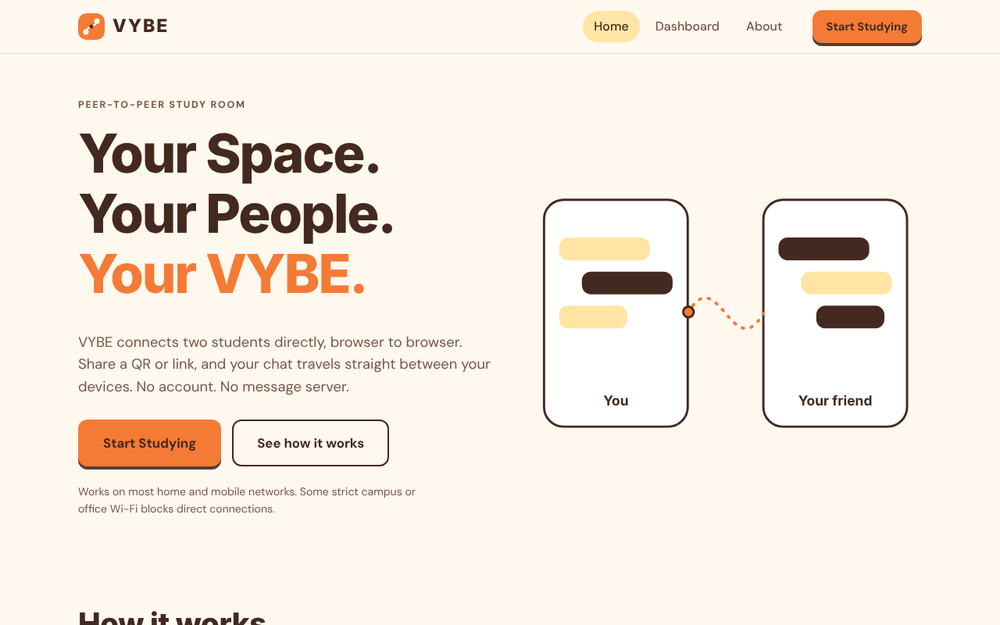
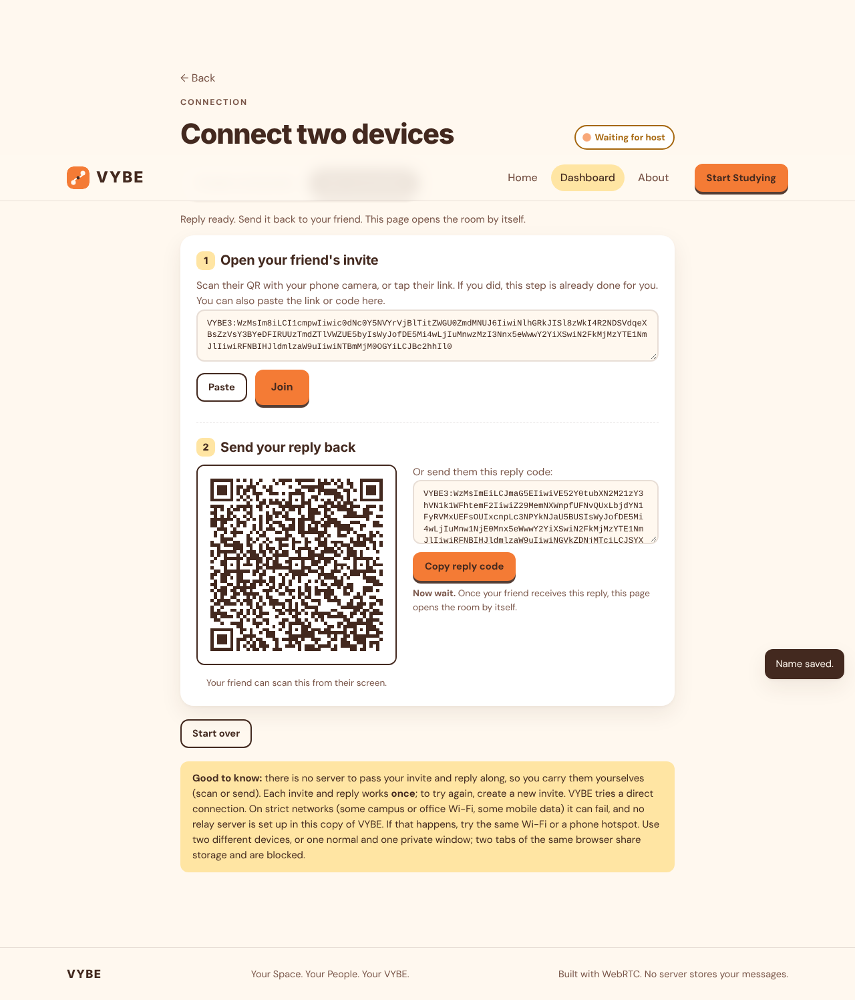
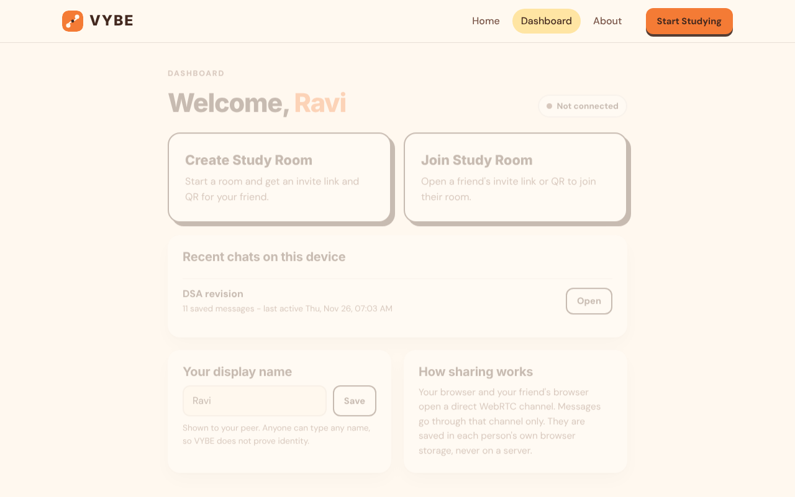
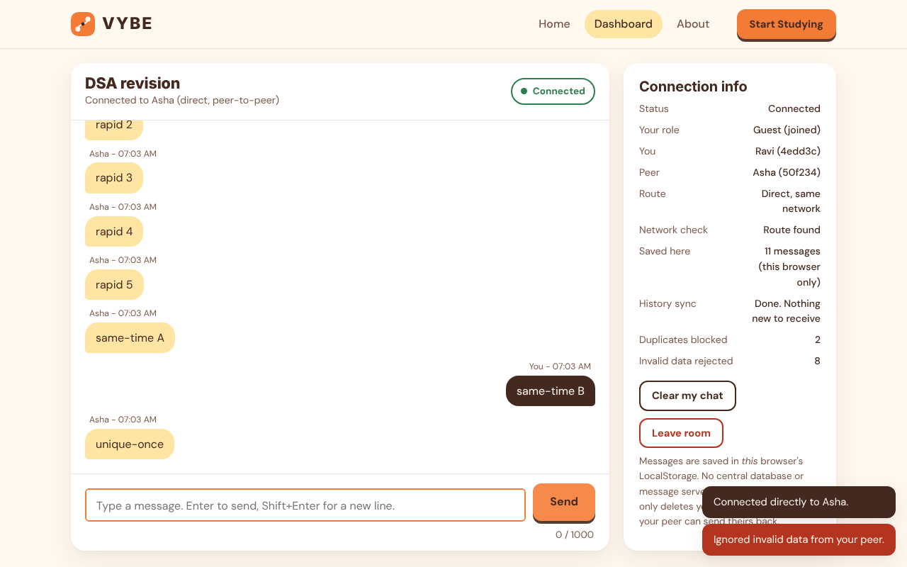
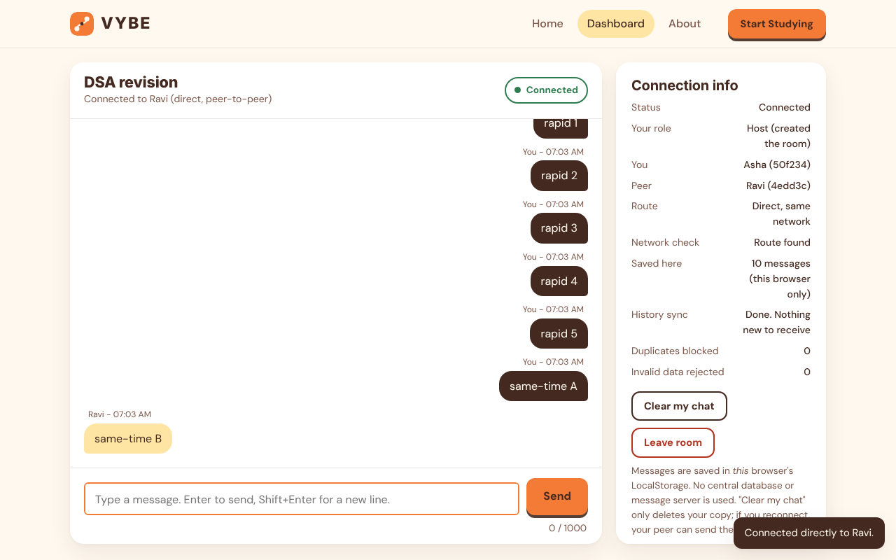
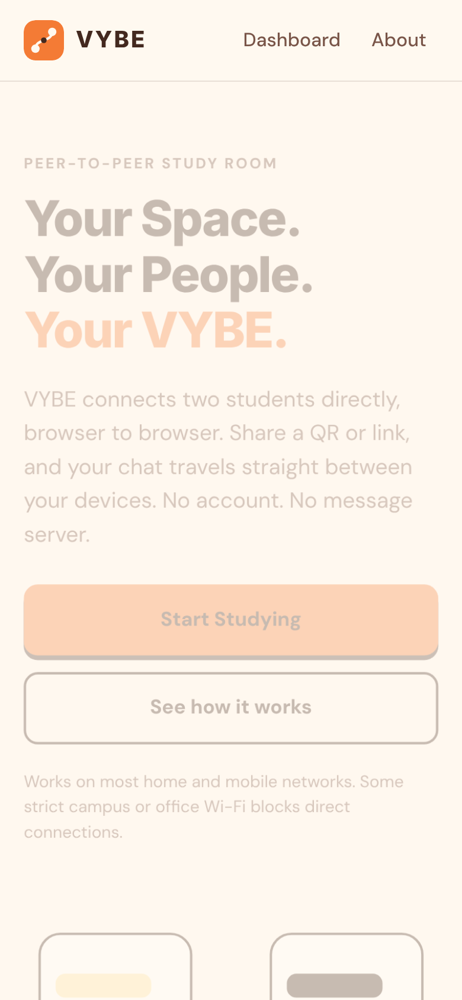
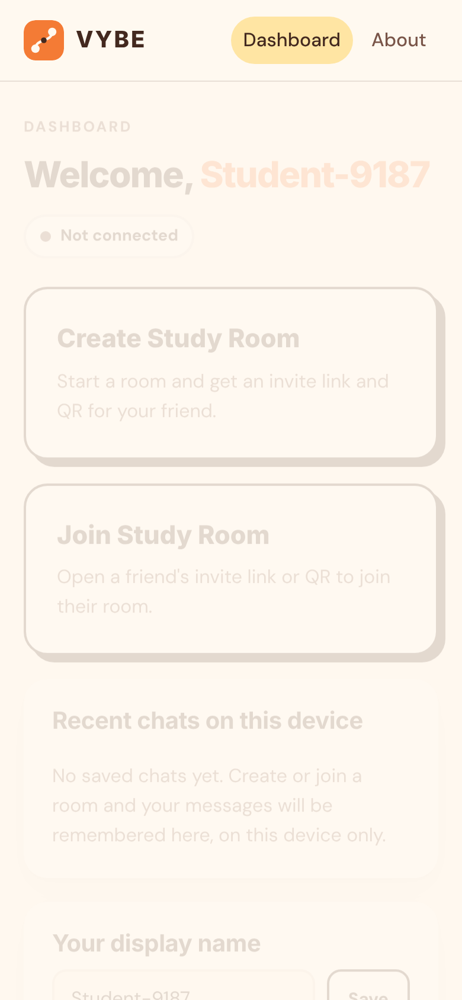
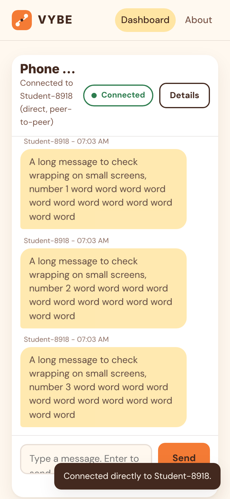

# VYBE — Peer-to-Peer Study Room

> **Your Space. Your People. Your VYBE.**

| | |
|---|---|
| **Project** | VYBE |
| **Developer** | Karuna Chawla (individual project) |
| **SAP ID** | 590027865 |
| **GitHub** | [karunachawla000](https://github.com/karunachawla000) |
| **Live app** | https://karunachawla000.github.io/P2P_App-VYBE/submissions/karuna-chawla-vybe/ |
| **Course** | B.Tech CSE, UPES — Decentralised (P2P) Web Application assignment |

## What the app does

VYBE lets two students chat directly, browser to browser, using WebRTC (`RTCPeerConnection` and `RTCDataChannel`).
**No server stores or forwards messages and there is no database.** There is also no signalling server: the two
students pass a short **invite** (link / QR) and a short **reply** (code / QR) to each other by hand. When the
DataChannel opens, all messages travel directly between the two devices. Chats are saved only in each person's own browser (LocalStorage).

## How to use it

1. **Student A** opens the live app → *Start Studying* → *Create Study Room* → type a room name → *Create invite*.
2. A shows the QR to B or sends the link (WhatsApp, e-mail, …).
3. **Student B** (another device) scans the QR with the phone camera or taps the link. VYBE opens and creates the **reply** by itself.
4. B sends the reply code back to A (Copy / Share), or A scans it with *Scan QR* where the browser supports it.
5. A pastes the reply. It connects by itself. Both screens open the room when the channel is really open.
6. Chat. Your history is saved on your device. To reconnect later press *Reconnect*: one person creates a **new** invite, the other joins with it.

Each invite and reply works **once**. If a connection fails, create a new invite.

## Technologies and services

- HTML5, CSS3, vanilla JavaScript (no framework, no build step, no npm for the app). WebRTC, LocalStorage, GitHub Pages.
- **Google public STUN servers** (`stun.l.google.com:19302`, `stun1…`): only to learn each device's public address. No chat data goes through them.
- **TURN relay (optional, not included):** supported, but needs *your own* credentials in `js/ice-config.js` (see below).
- **QR generator:** bundled *QRCode for JavaScript* by Kazuhiko Arase (MIT). "QR Code" is a registered trademark of DENSO WAVE INCORPORATED.
- **Google Fonts** (Bricolage Grotesque, DM Sans), cosmetic only.
- Playwright (and `node-turn`, test-only) are used only for the optional automated tests.

## Assignment problems solved

| # | Problem | How it is solved | Code |
|---|---|---|---|
| 2 | Data lost on refresh | Every message is saved in LocalStorage and re-validated on load. History survives a refresh and shows offline from the dashboard. | `chat.js` `openRoom`, `saveCurrent` |
| 4 | Duplicate messages | Each message has a unique ID; a `Set` check drops repeats (live and during history sync). | `chat.js` `insert` |
| 3 | Wrong message order | A logical clock (`seq = max(seen) + 1`) plus tie-breakers (timestamp, sender ID, message ID) gives the same order on both devices. | `chat.js` `compareMessages` |
| 9 | Malicious input | Packets are size-limited, JSON-checked, type-checked and field-validated; extra fields are dropped; spoofed senders are rejected; text is drawn with `textContent`, never `innerHTML`. | `chat.js` `parsePacket`, `script.js` `renderMessages` |
| 1 (bonus) | Late joiners see no history | On connect each side requests the other's saved history; it arrives in batches of 20 and is merged by ID. | `script.js` `sendHistory`, `chat.js` `mergeMessages` |

Not solved: group rooms, identity verification, deleting data on both sides (see Limitations).

## Development challenges

These are problems that were found and fixed while hardening the project for submission. Each was reproduced by a test or inspection first.

### 1. Host stayed on "Connecting…" after the room opened
- **Problem:** On the host, the room screen opened but the status pill said *Connecting…* and the peer line said *Not connected*. The original end-to-end test failed on this when re-run.
- **Why:** `acceptAnswer()` set the state to *connecting* only after `setRemoteDescription` finished. On a fast link the DataChannel was already open by then, so *Connected* was overwritten by *Connecting*.
- **What was tried:** Printed both pages' state after connecting (host wrong, guest right), then traced the order of events in `webrtc.js`.
- **Solution:** Once the channel has opened, setup states can never come back (`_setState` guard), and `acceptAnswer` no longer re-enters *connecting* after open. A test watches the page and fails if "Connected" ever shows before the channel is open.

### 2. TURN (relay) addresses were silently thrown away
- **Problem:** The compact code kept only the 5 highest-priority UDP candidates. With a TURN server, the relay candidate would have been cut, so the relay would never be used. TCP candidates were never kept either.
- **Why:** Relay candidates always have the *lowest* priority, so a "best 5" cut removes them first.
- **What was tried:** A unit test with 12 candidates (6 local, 4 public, 2 relay) reproduced the loss. Then a quota per kind was tried, and finally verified with a real relay.
- **Solution:** Candidates are chosen per kind (2 relay, 2 public, 3 local, 2 TCP, at most 8). Relay candidates now survive; a local TURN test (`tests/e2e-turn-relay.js`) connected two browsers using *only* the relay, and the code stayed about 283 characters.

### 3. Paste, Paste button, Connect and QR scan could start duplicate connections
- **Problem:** Pasting a reply fires the paste handler, the Paste button and the Connect button almost together, so the same reply or invite could be applied more than once or create extra connections.
- **Why:** The guards ran after the first `await`, so several calls passed them before any finished.
- **What was tried:** A test fires 3 paste events + 3 clicks + the Paste button at once and counts `RTCPeerConnection` objects and how many times the answer is applied.
- **Solution:** A small state machine (`idle → checking → used`) set *before* the first `await`, plus one-use flags inside `Connection`. The result: one connection, one answer applied, the reply box locks, and buttons show *Preparing…* / *Connecting…*.

### 4. Invite links could point to localhost, `file://` or a page with `index.html`
- **Problem:** An invite made while testing locally contained a link nobody else can open.
- **Why:** The link was built from the current page address.
- **What was tried:** Checked invites from the public address, from `localhost` and from `file://`.
- **Solution:** On the public site the link uses that page (normalised, no `index.html`). On localhost/LAN/`file://` it uses the public address from `<meta name="vybe-public-url">`. If none is set, it shows a clear warning (localhost) or refuses (`file://`).

### 5. The invite QR code would not decode in one decoder
- **Problem:** The invite QR failed to decode in an independent OpenCV decoder while the reply QR worked.
- **Why:** The canvas was drawn at 324 px but stretched by CSS to 300 px. That uneven scaling blurs the QR modules.
- **What was tried:** Decoded the same image at other scales and with OpenCV's second detector. Both read the exact link, proving the QR data was right and the problem was the blur.
- **Solution:** The QR is drawn at a size that fits the screen and shown at its real pixel size. Tests decode both QR codes back to the exact text.

### 6. Closing the connection when a phone only hides the page (found by code review, not tested on a phone)
- **Problem:** `pagehide` closed the connection every time.
- **Why:** On mobile browsers `pagehide` also fires when a page is only kept in the back/forward cache.
- **What was tried:** Read the browser event rules; no phone test was possible here.
- **Solution:** The connection is closed only when `event.persisted` is false. **This still needs a real phone test.**

## Screenshots

| Landing | Connect + reply | Dashboard |
|---|---|---|
|  |  |  |

| Room (guest) | Room (host) |
|---|---|
|  |  |

| Mobile landing | Mobile dashboard | Mobile room |
|---|---|---|
|  |  |  |

Connect screen before a reply: `screenshots/01-connect.png`.

## Testing

Run in headless Chromium on one computer, using two separate browser profiles. The app was served at the exact address `https://karunachawla000.github.io/VYBE/VYBE/` (requests answered from local files).

| Test | Command | Result |
|---|---|---|
| Syntax check of every `.js` file | `node --check <file>` | passed |
| Unit tests: validation, duplicates, ordering, persistence, history batches, compact code, relay/TCP candidate selection, hostile codes, ICE config | `node tests/chat.test.js` | **84 / 84 passed** |
| End-to-end, two browser profiles | `node tests/e2e-two-peers.js` | **100 / 100 passed** |
| Relay test with a *local* TURN server (relay-only) | `node tests/e2e-turn-relay.js` | **12 / 12 passed** |

What the end-to-end test covers: GitHub Pages path and assets; invite and reply generation; QR codes decode back to the exact text; duplicate paste/click on both sides; "Connected" only after the channel opens; chat both ways; HTML shown as text; invalid, oversized and spoofed packets rejected; refresh keeps history; reconnect with a new pair and history sync; a stale reply ends in a clear *Failed* state; invites made locally use the public URL; layouts at 320, 360, 390, 768 and 1366 px.

### Tested on real devices

| Test | Result |
|---|---|
| Laptop on Wi-Fi + phone on **mobile data** (two different networks), live GitHub Pages URL | **Connected** on 26 Nov 2026. Chat worked in both directions. Route shown in the app: "Direct over the internet" (no TURN relay was used). |

This is **one** successful test on one pair of networks. It does not prove every network works.

### Not tested (do these yourself before claiming them)

| Test | Result |
|---|---|
| Real phone camera scanning the invite QR (Android, iPhone) | ☐ not tested (decoded by software only) |
| In-app *Scan QR* button, *Share…* button, Copy/Paste buttons on a phone | ☐ not tested |
| Safari and Firefox (only Chromium was used) | ☐ not tested |
| A real TURN provider (the relay test used a local test server) | ☐ not tested; no credentials are included |
| Campus Wi-Fi, phone sleep / Wi-Fi drop on a real device | ☐ not tested |

**Remote connection is not guaranteed.** It connected once between a laptop on Wi-Fi and a phone on mobile data (see above). Other networks (campus Wi-Fi, other mobile carriers) have not been tested and may need a TURN relay.

## Limitations

- **No TURN credentials are included.** Without a relay, devices behind strict NATs or firewalls (some campus/office Wi-Fi, some mobile data) may fail to connect. Try the same Wi-Fi or a phone hotspot.
- **Browser-side TURN credentials are public.** This is a static site, so anyone can read `js/ice-config.js` and use your relay and data allowance. There is no safe place for a secret on GitHub Pages. Use a limited TURN username/credential from a provider with a usage cap, never an account API key, and change it after grading. Messages stay end-to-end encrypted (DTLS) on a relay.
- Two people per room. A reply must travel back to the host (scan or paste); one-scan connection needs a signalling server. iPhone Safari has no in-app QR scanner, so use Copy/Paste there.
- Invites contain network addresses (including your public IP). Share them only with people you trust.
- History sync works only while a peer holding the messages is online. "Clear my chat" deletes only your copy; a peer can send theirs back.
- No identity verification (anyone can type any name). LocalStorage is limited (~5 MB, latest 1000 messages per room) and is lost if site data is cleared.
- Text only.

### Adding your TURN server

1. Get TURN URLs, username and credential from a TURN provider (some have a free tier) or your own coturn server.
2. Open `js/ice-config.js`. In the `turn` list, delete the two lines marked `DELETE THIS WHOLE LINE`, then replace every `YOUR_...` value. Entries that still contain `YOUR_` are ignored on purpose.
3. Commit and push, then hard-refresh (Ctrl+Shift+R) on both devices. The *Connection info → Route* line says *Through a relay server (TURN)* when it is used.
4. To prove the relay works, temporarily set `forceRelay: true`, connect two devices, then set it back to `false`.

## Run locally

```bash
cd VYBE
python3 -m http.server 8080      # then open http://localhost:8080
```

`file://` does not work (WebRTC/clipboard need `http://localhost` or `https://`). Invites made locally point to the public GitHub Pages address, so the friend's device must open the **deployed** version. For a purely local test, open two different browser profiles (or one normal and one private window), and temporarily set `vybe-public-url` in `index.html` to empty.

Run the tests (needs Node 18+):

```bash
npm i -D playwright node-turn && npx playwright install chromium
node tests/chat.test.js
python3 -m http.server 8080 &    # needed once for the "running locally" check
node tests/e2e-two-peers.js
node tests/e2e-turn-relay.js
```

## Project structure

```
VYBE/
├── index.html        all pages (landing, dashboard, connect, room, about)
├── style.css         design and responsive layout
├── script.js         UI logic and event wiring
├── js/ice-config.js  STUN + optional TURN settings (the only file with TURN details)
├── js/webrtc.js      connection, compact codes, validation (no DOM)
├── js/chat.js        messages, storage, validation, ordering (no DOM)
├── js/qrcode.js      bundled QR generator (MIT)
├── assets/logo.svg
├── tests/            chat.test.js, e2e-two-peers.js, e2e-turn-relay.js
├── screenshots/
└── README.md
```
